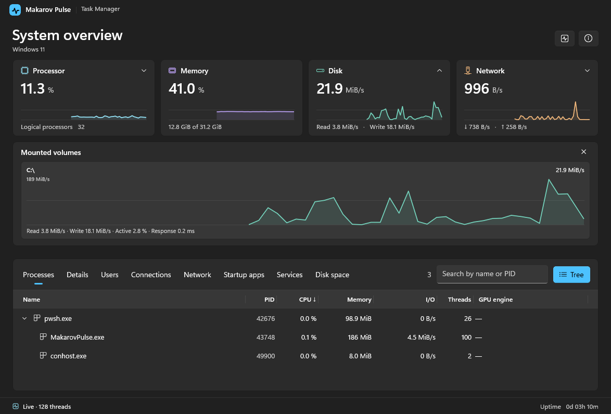

# Makarov Pulse

A native Windows 11 task manager developed by Mykhailo Makarov. Makarov Pulse brings live resource graphs, a searchable process tree and a process inspector into one WinUI 3 window.

## Why use Makarov Pulse over Windows Task Manager?

| When you want to… | What Makarov Pulse gives you today |
| --- | --- |
| Identify the current CPU or memory leader | Hover over the CPU or memory graph to see the process name, PID and latest measured value. |
| Find a worker process and understand who launched it | Search by name or PID in **Tree** mode. The results retain the chain of parent processes. Typing a worker's PID can reveal the browser, editor or build tool that spawned it. |
| Find the core, disk or adapter behind a busy overview graph | Open the device view from the CPU, disk or network card. The graphs show activity per logical processor, disk and network adapter. When Windows cannot supply physical disk counters, the disk view shows mounted volumes. Disk tiles separate throughput from active time and response time. |
| Compare system load with one process | Watch a process’s CPU, private memory, threads and handles while the main window continues to update. |
| Find what fills a drive or project folder | Scan it from **Disk space**, then open a tile to see which subfolders and files account for its size. |

Windows Task Manager provides system-wide performance, process details and services in dedicated views. The table describes workflows available in the current Makarov Pulse build. [Windows Task Manager overview](https://learn.microsoft.com/en-us/troubleshoot/windows-server/support-tools/support-tools-task-manager)



*The Disk card shows combined throughput, with separate read and write rates below the graph. The expanded panel shows the mounted volume that supplied these readings.*

## Run

Open the portable `MakarovPulse.exe` on Windows 11 x64. It bundles .NET and the Windows App SDK and extracts its runtime files on first launch. Makarov Pulse follows the Windows app theme and accent color. The **ⓘ** button in the overview header opens **About Makarov Pulse**, with the version and developer credit.

## Using the monitor

- Press **Ctrl+F** to search by process name or PID. Type `pid:` and a number to match one process exactly.
- Every table tab supports column sorting. Click a heading or focus it with **Tab** and press **Enter** or **Space**. The arrow shows the direction. Activate the heading again to reverse it. Drag a heading to reorder it or its right divider to resize it. Right-click a heading or use the Menu key for visibility, pinning and keyboard layout commands. Makarov Pulse restores each tab’s layout and sort order across restarts.
- The process list opens as a tree of parent and child processes. Collapse a branch to see the number of processes in it and their combined CPU, memory, I/O and threads. Toggle **Tree** for a flat list. Select a row to inspect its executable path, command line, user, priority, start time, counters, busiest threads and its GPU engine. The inspector has separate pages for threads, hosted services and connections.
- Switch to **Details** for a flat list with every counter in its own column: parent PID, session, working set, private bytes, read and write rates, handles, start time, priority, user and command line. Makarov Pulse loads the last three in the background. The displayed priority class updates when a process's base priority changes. Details follows the **Processes** sort order until you choose a heading in Details. Scroll horizontally to reach the command line in a narrow window. Hover over a truncated process name to read it in full. Double-click a row to show that process with its parents.
- Switch to **Users** for the processes, CPU, memory, I/O and threads of each session.
- Switch to **Connections** to list TCP connections, listeners and bound UDP ports with their owning processes. Filter by process, PID, address, port, protocol (such as `UDPv6`) or TCP state (such as `LISTENING`). Double-click a row to show its process. The process inspector lists each TCP connection with its local and remote endpoints. TCP listeners and UDP bindings show their local endpoint. Scoped IPv6 addresses include the interface index, for example `[fe80::1%7]:443`. If Windows withholds a socket table, Makarov Pulse identifies it and keeps the available results.
- Switch to **Network** for every network adapter with its type, address, MAC address, status, link speed and current receive and send rates. Under each adapter are the devices Windows has recently exchanged packets with on that network, taken from the ARP and IPv6 neighbour tables, with the gateway first by default. Sorting keeps devices under their adapter. The **Activity** heading sorts adapters by combined receive and send rate. Device names come from reverse lookups that run while the tab is open. Hover over a row for all its addresses, the gateway and the DNS servers. Search by name, address or MAC.
- Switch to **Startup apps** for the entries in the Run and RunOnce registry keys and the Startup folders, with their command, source, whether Windows has them enabled and whether their program is running now. Double-click an entry, or press **Enter**, to edit its name, command and enabled state in Makarov Pulse. Registry Editor is not involved. Right-click an entry, or press the Menu key, to enable or disable it, edit it, delete it or show a Startup folder file in File Explorer. Enabling and disabling use the same switch as Task Manager and keep the entry. Renaming an entry keeps its enabled state.
- Switch to **Services** to list Windows services with their status and host process. Search by name, description or PID. Double-click a running service to show its process on the **Processes** tab. Right-click a service to start, stop or restart it or to change its startup type, including delayed automatic start. When other services depend on it, Pulse lists them for confirmation. A restart brings back the services it stopped in dependency order.
- Use the chevron on the CPU, disk or network card to open its device view, and again to close it. The buttons are reachable with **Tab**. Readings refresh automatically once per second.
- Click a device tile, or press **Enter** or **Space** on it, to expand it into a larger graph with its vertical scale labelled. Arrow keys move between tiles. Select the tile again to shrink it.
- Open **Disk space** to scan the selected drive automatically. The folder list and treemap fill in as the scan runs. Select another drive or use **Choose a folder to scan** to switch targets. Returning to the tab preserves your current scan and folder. Click **Scan** to refresh the results. The treemap groups smaller items so that tile areas reflect their share of the whole folder. Sort the list by name, size, allocated bytes or share without moving the treemap tiles. Use the context menu on an individual file or folder to select it in File Explorer. The list includes every subfolder, including empty and unreadable ones. It shows the 20 largest files individually and groups the rest. Click a folder to drill down and use **Up one level** to go back. Cancelling preserves the partial result. Size is the logical file length. **On disk** shows allocated bytes reported by the file system. An incomplete allocation total appears as a dash. The scan skips reparse points and offline files.
- Changing a service or a machine-wide startup entry needs administrator rights. The menus offer **Restart Makarov Pulse as administrator** when Makarov Pulse runs without them. Entries of the current user can be changed without elevation.
- Open **Diagnostics** beside About to see current GPU memory and engine utilization.
- Choose **Watch process** in the inspector to follow that process while inspecting other rows.
- Open **File and socket activity** in Diagnostics to see current transfer rates by file and socket. While this view is open, matching rates also appear in **Connections**. Windows may require elevation. Closing the view releases its ETW session.
- **Open file location** in the process inspector selects the executable in File Explorer. The button becomes available when Windows supplies the executable path.
- In **Disk space**, select **Windows cleanup recommendations** to review temporary files and other cleanup candidates in Windows Settings.
- **End task** asks for confirmation. Makarov Pulse checks the selected process's creation time and critical status on the same handle it uses to end the process.

### Reading the numbers

| Metric | Meaning |
| --- | --- |
| CPU | A process at 100% uses the capacity of all logical processors on the machine. |
| Memory | The card shows physical memory in use. Process rows show working sets, which may include shared pages. The inspector also shows private bytes. |
| Disk | The headline combines read and write throughput. Both rates appear below the graph. When physical disk counters are unavailable, Pulse measures local storage activity per mounted volume. Expand the card or hover over the rates to see the source. If some volumes are unavailable, the caption shows how many contributed. |
| Process I/O | Bytes read and written by a process, including file, device and network I/O. These rates can differ from physical disk throughput. |
| Logical processors | One tile per logical processor, on a fixed 0–100% scale. Machines with several processor groups show the group number. |
| Disks and volumes | Read and write rates for each physical disk or mounted volume. **Active** is the share of time the disk spent servicing requests. **Response** is the average time per transfer. A busy disk with low throughput and a long response time is limited by latency. |
| Network adapters | Receive and send rates per adapter, with the link speed Windows reports. |
| Network | Receive and send rates across active hardware adapters. On virtual-only systems Pulse uses the available active adapters. Loopback, tunnel and packet-filter interfaces are excluded. With every eligible adapter disconnected, both rates show zero. |

A dash indicates that a counter is unavailable or another sample is needed. CPU and memory charts use a 0–100% scale. Throughput charts scale to the highest value in the visible window. Disk and adapter tiles show that maximum in the corner of each graph. A tile disappears when Windows stops reporting its device, and the other tiles continue updating.

## Languages

Makarov Pulse ships with English, Ukrainian, Spanish, French, German, Russian and Simplified Chinese. At startup it chooses the first supported language in the Windows preferred language list, including regional variants such as `de-CH`. English is the fallback. To change the language, reorder **Settings → Time & language → Language & region → Preferred languages** and reopen Makarov Pulse. Numbers, dates and times use the Windows regional format.

English strings live in [Strings.resx](Localization/Strings.resx). To add a translation, copy it to `Localization/Strings.<language>.resx`, translate the values, preserve the numbered format placeholders, and add the language tag to `UiText.Supported`. Keep identifiers, comments and documentation in English.

## Build from source

Use Windows 11 x64, the .NET 11 SDK and Windows SDK 10.0.26100. The project uses C# 15 and WinUI 3 from Windows App SDK 2.7.0. Run these commands from the directory containing `Pulse.csproj`. The first restore downloads packages from NuGet.

```powershell
dotnet run --project Pulse.csproj -c Release
```

Build a self-contained `publish/MakarovPulse.exe` with the portable profile. The profile bundles .NET and the Windows App SDK into one compressed executable.

```powershell
dotnet publish Pulse.csproj -c Release -p:PublishProfile=Portable -o publish
```

`publish.ps1` runs the same publish step and then the Windows regression checks against a protected test bundle, and writes their output to `publish/test-results.txt`. Pass `-SkipChecks` to publish only, or `-Output <folder>` to choose another folder.

```powershell
powershell -File .\publish.ps1
```

## Run the Windows regression checks

From the project directory, run `powershell -File .\tests\Run.ps1`. The test build opens its own WinUI window for each shipped language. It checks live sampling, device removal and recovery, short-window layout, actual logical-processor readings and gaps in live graphs. The disk space checks create a temporary folder tree and verify byte totals, small-file grouping, treemap proportions, navigation, keyboard focus, cancellation and rescanning. The checks activate all main table headings in both directions. They measure translated headings and the Details name column in a narrow window and verify numeric ordering, adapter grouping and selection after sorting. Services and Connections report when Windows restricts access to their data. Device changes and missing time intervals are simulated in the test process. Build output and reports go under `obj/window-checks`.

Add `-Extended` to exercise the Disk card with a 4 MiB write-through write and an uncached read, and to verify cancellation during a live system-volume scan.

## Release integrity

The portable profile restores the pinned Obfuscar tool and renames selected internal sorting, scanning and trace-aggregation code before bundling. WinUI bindings, native entry points, and translations keep their public names. The release omits debug symbols. The private mapping file stays in the intermediate build directory. Managed code can still be inspected. [Obfuscar](https://github.com/obfuscar/obfuscar)

The publish script writes a SHA-256 checksum beside the executable. To sign a distribution, pass the thumbprint of your code-signing certificate from the current user's Personal store and your issuer's HTTPS timestamp service. The script uses the Windows SDK SignTool and verifies the resulting Authenticode signature. [Microsoft SignTool documentation](https://learn.microsoft.com/en-us/windows/win32/seccrypto/signtool)

```powershell
.\publish.ps1 -CertificateThumbprint $thumbprint -TimestampServer $timestampUrl
Get-AuthenticodeSignature .\publish\MakarovPulse.exe
Get-FileHash .\publish\MakarovPulse.exe -Algorithm SHA256
```

## Development roadmap

The roadmap tracks live device measurements, process inspection and Windows acceptance checks. [Roadmap](ROADMAP.md)

